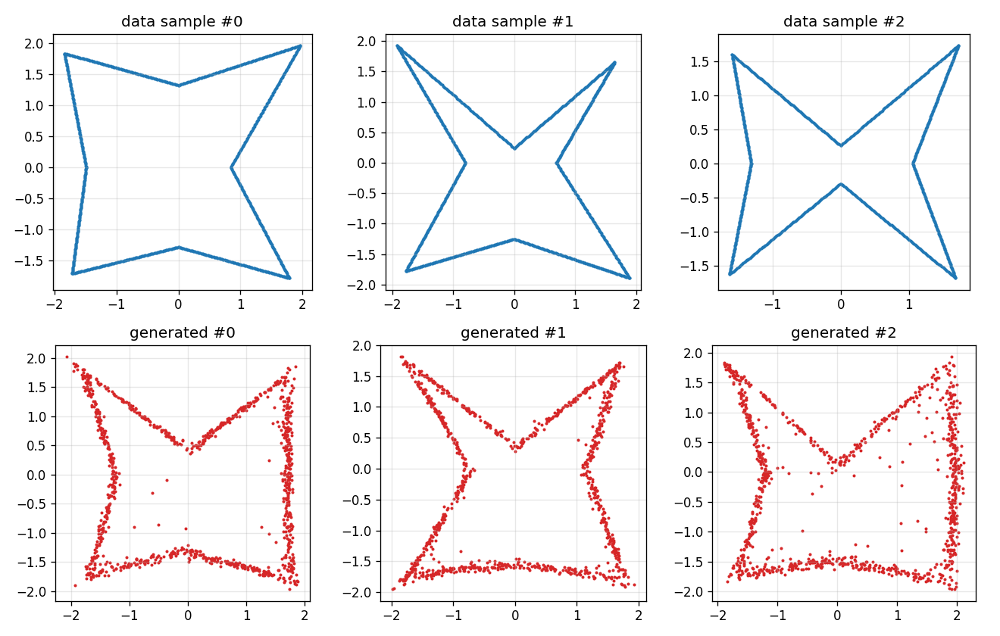
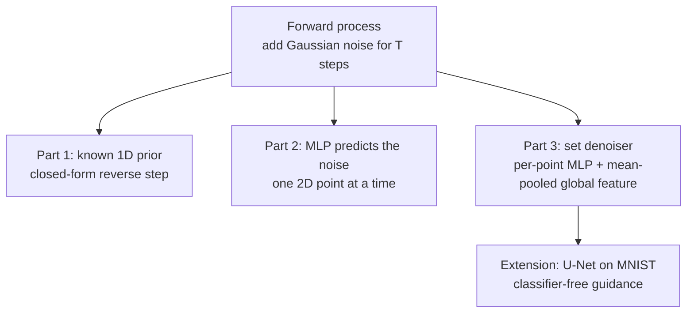
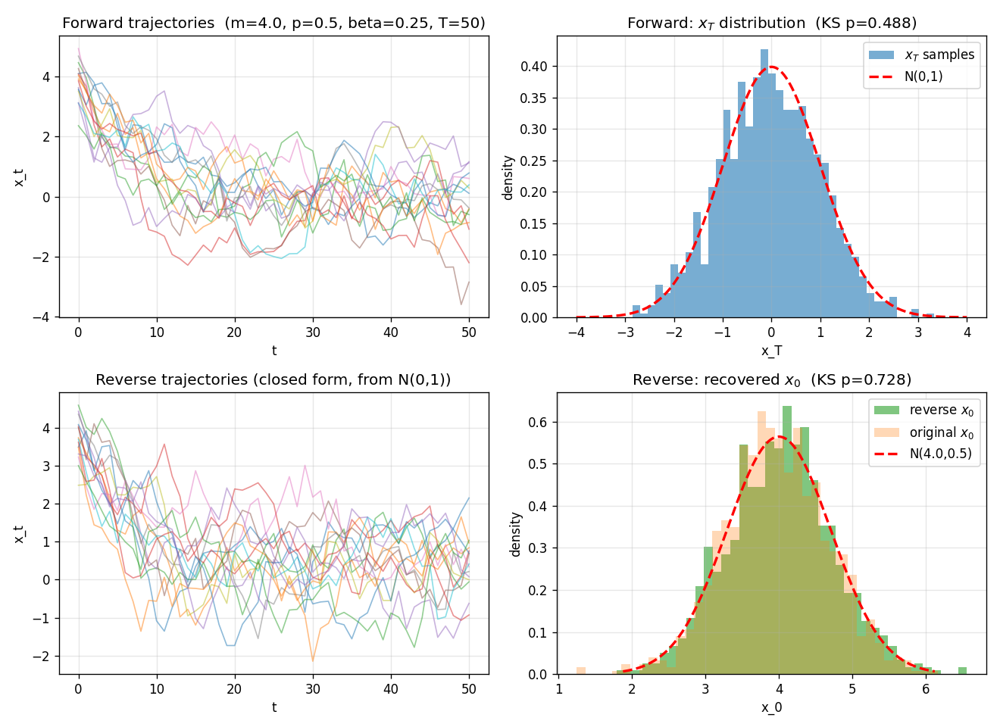
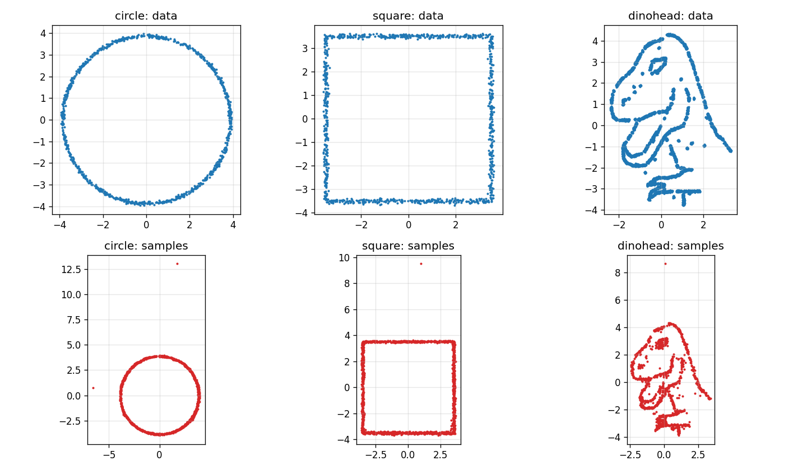
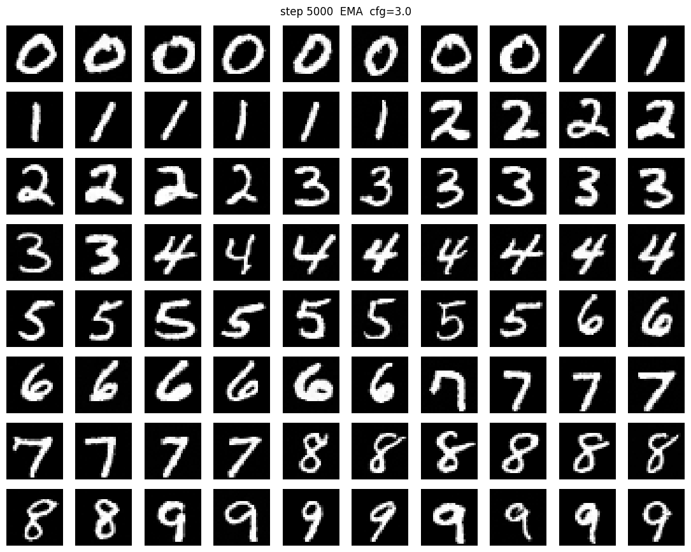

# Diffusion Models from Scratch: 1D, 2D Point Clouds and Sets

DDPM implemented in PyTorch from the derivation up, in three steps: a closed-form 1D reverse process, a per-point 2D denoiser, and a permutation-equivariant denoiser for sets of 1,024 points. An extension trains a 15.7M-parameter U-Net on MNIST with classifier-free guidance.

**English** · [中文](README.zh-CN.md)

<p align="center">
  
  <br><em>Set diffusion: training shapes (top) and generated shapes (bottom). Each cloud of 1,024 points is denoised jointly.</em>
</p>

## Results

- **1D, closed form:** the reverse process recovered the prior N(4, 0.5) with mean 4.014 and variance 0.511 (KS test p = 0.728). The forward process reached N(0, 1) after 50 steps (KS p = 0.488).
- **2D, per point:** a 57,986-parameter MLP learned circle, square and dinosaur-head shapes. Denoising each point independently left one or two extreme outliers per 1,500 samples.
- **Sets:** a PointNet-style denoiser with 99,074 parameters adds a shared global feature. Its generated stars have a consistent scale and orientation and no isolated outliers.
- **MNIST extension:** a 3-level U-Net with self-attention (15,722,625 parameters) and classifier-free guidance (w = 3.0). Each model trained for 5,000 steps on one T4 GPU in 22–28 minutes, with fp16 and EMA.

## How it works



**Part 1.** With a Gaussian prior on x₀, the reverse conditional q(x_{t−1} | x_t) is Gaussian and can be written in closed form. No network is needed. The forward run uses a constant schedule β = 0.25 and T = 50.

<p align="center">
  
  <br><em>Part 1: the forward process ends near N(0, 1), and the closed-form reverse process recovers the prior N(4, 0.5).</em>
</p>

**Part 2.** A 4-layer MLP (GELU, hidden size 128, sinusoidal time embedding) predicts the noise added to a single 2D point. It uses a linear schedule from 1e-4 to 0.02 with T = 1,000 and 15,000 training steps per shape.

<p align="center">
  
  <br><em>Per-point denoising reproduces the shapes, but a few points land far outside them (note the axis ranges in the bottom row).</em>
</p>

**Part 3.** The per-point model cannot see the other points, so nothing stops one sample from drifting away. The set denoiser mean-pools a global feature over all 1,024 points and gives it to every point. The output stays permutation-equivariant: reordering the input points reorders the predicted noise in the same way. It trains for 8,000 steps with T = 500.

**Extension.** A 3-level U-Net (28 → 14 → 7 pixels, GroupNorm, SiLU, residual blocks, multi-head self-attention at 7 × 7) denoises MNIST digits. For guidance, the class label is replaced by a null token with probability 0.1 during training. Final training MSE was 0.0230 (unconditional) and 0.0221 (class-conditional).

<p align="center">
  
  <br><em>Class-conditional samples after 5,000 steps (EMA weights, guidance scale 3.0).</em>
</p>

## Tech stack

- **Language:** Python
- **Libraries:** PyTorch, NumPy, SciPy (KS tests), Matplotlib, torchvision (MNIST)
- **Hardware:** CPU for Parts 1–3; one T4 GPU (Colab) for the MNIST extension

## Run it

```bash
pip install -r requirements.txt
python scripts/run_phase1.py          # Part 1, runs in seconds, writes figures/phase1_*.png
python extension/train_mnist.py --help
```

Part 1 needs no data and reproduces the numbers above. `extension/train_mnist.py` downloads MNIST through torchvision; `extension/colab_train.ipynb` runs it on Colab.

Parts 2 and 3 used toy point sets and a sinusoidal-embedding helper that came with the course. They are not included here, so `scripts/run_phase2.py` and `run_phase3.py` are for reading. To run them, put your own point sets in `data/shapes/<name>_pts.npy` and `data/sets/stars_data.npy`, and add a `SinusoidalEmbedding(size, scale)` module in `src/sinusoidal_embedding.py`.

## Repository layout

```
├── src/
│   ├── forward_process.py   noise schedules and q(x_t | x_0)
│   ├── reverse_closed.py    closed-form 1D reverse process (Part 1)
│   ├── model.py             per-point noise MLP (Part 2)
│   ├── model_advanced.py    permutation-equivariant set denoiser (Part 3)
│   ├── train.py             training loops and DDPM ancestral sampling
│   └── utils.py             paths, seeding, data loading
├── scripts/run_phase1.py … run_phase3.py
├── extension/               MNIST U-Net, DDPM wrapper, training script, Colab notebook
└── docs/images/             README figures
```

## Limitations

- Toy data: 1D Gaussians, 2D shapes and one family of star-shaped sets.
- MNIST samples were judged by eye. No FID or other sample-quality metric was computed.
- Sampling takes T sequential network calls; faster samplers such as DDIM were not implemented.

## Links

- Portfolio: https://tjiewgnil.github.io/#diffusion

## License

Code is released under the [MIT License](LICENSE). Course project, Image Analysis, Chalmers University of Technology, spring 2026.
