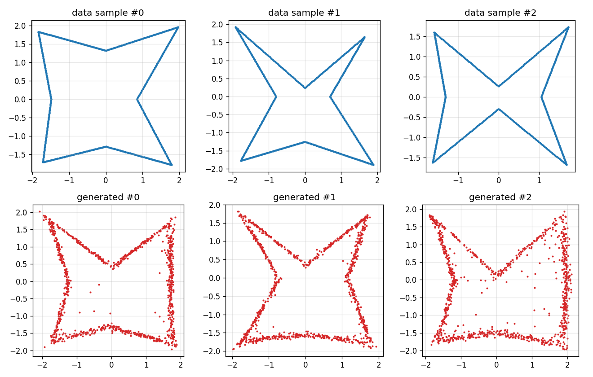
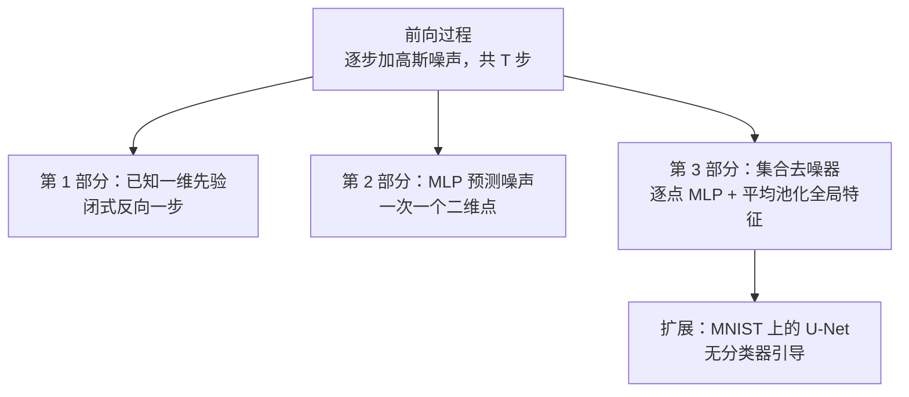
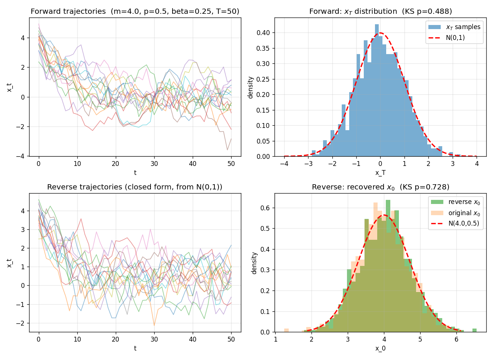
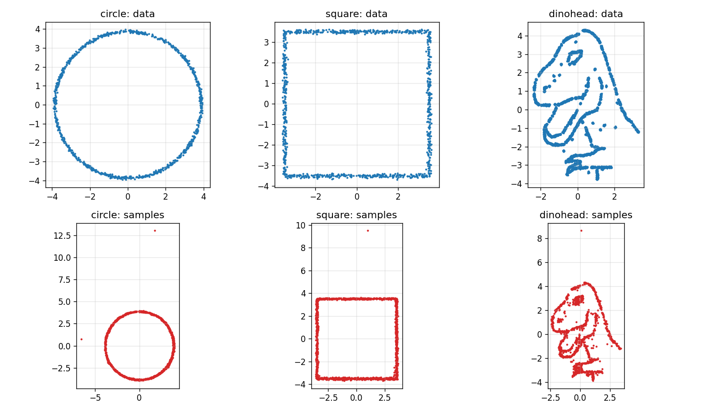
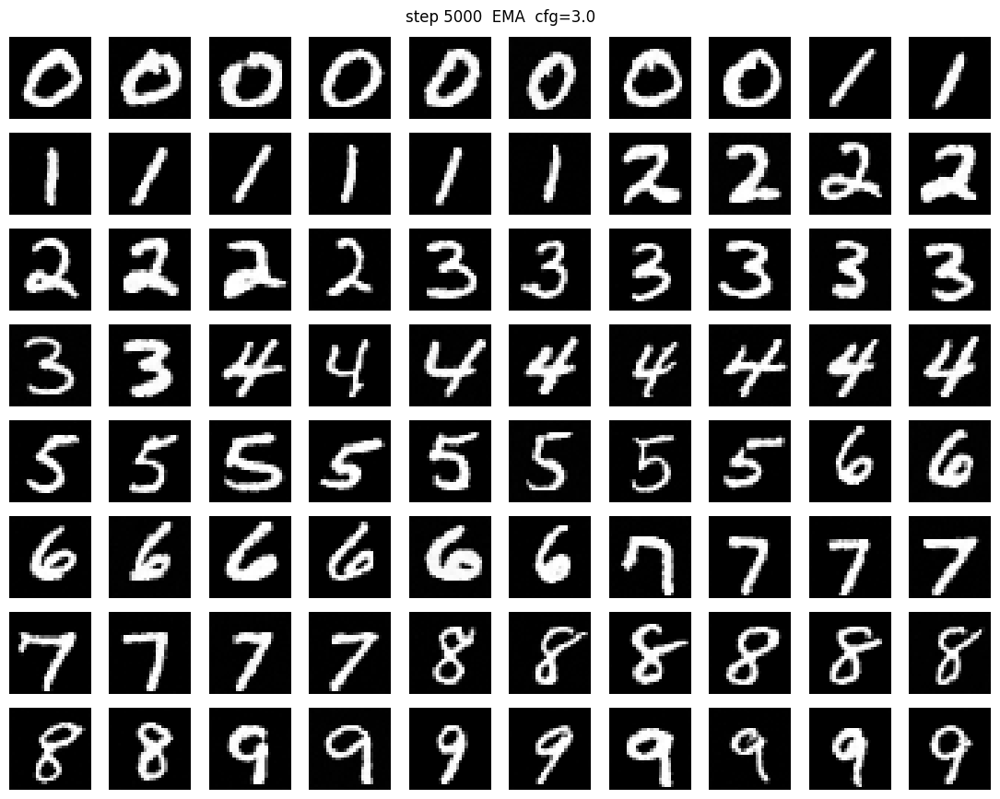

# 从零实现扩散模型：一维、二维点云与点集

从公式推导出发，用 PyTorch 分三步实现 DDPM：一维闭式反向过程、二维逐点去噪器，以及面向 1,024 个点集合的置换等变去噪器。扩展部分在 MNIST 上训练了一个 1,570 万参数、带无分类器引导的 U-Net。

[English](README.md) · **中文**

<p align="center">
  
  <br><em>集合扩散：训练样本（上）与生成结果（下）。每个 1,024 点的点云整体一起去噪。</em>
</p>

## 成果

- **一维闭式解：** 反向过程还原了先验 N(4, 0.5)，得到均值 4.014、方差 0.511（KS 检验 p = 0.728）。前向过程 50 步后接近 N(0, 1)（KS 检验 p = 0.488）。
- **二维逐点：** 一个 57,986 参数的 MLP 学会了圆形、正方形和恐龙头三种形状。每个点单独去噪，每 1,500 个样本里会留下一两个远离形状的离群点。
- **点集：** PointNet 风格的去噪器有 99,074 个参数，加入了所有点共享的全局特征。生成的星形尺度和朝向一致，没有孤立的离群点。
- **MNIST 扩展：** 3 级 U-Net，带自注意力（15,722,625 个参数），使用无分类器引导（w = 3.0）。每个模型在一张 T4 GPU 上训练 5,000 步，用时 22–28 分钟，使用 fp16 和 EMA。

## 工作原理



**第 1 部分。** x₀ 的先验是高斯分布时，反向条件分布 q(x_{t−1} | x_t) 也是高斯分布，可以直接写出闭式解，不需要神经网络。前向过程使用常数调度 β = 0.25，T = 50。

<p align="center">
  
  <br><em>第 1 部分：前向过程最终接近 N(0, 1)，闭式反向过程还原出先验 N(4, 0.5)。</em>
</p>

**第 2 部分。** 一个 4 层 MLP（GELU，隐藏层 128，正弦时间编码）预测加在单个二维点上的噪声。使用从 1e-4 到 0.02 的线性调度，T = 1,000，每种形状训练 15,000 步。

<p align="center">
  
  <br><em>逐点去噪能还原形状，但会有少数点落在形状之外（注意下排的坐标轴范围）。</em>
</p>

**第 3 部分。** 逐点模型看不到其他点，所以没有机制阻止某个样本越走越远。集合去噪器对全部 1,024 个点做平均池化，得到一个全局特征，再提供给每个点。输出保持置换等变：输入点的顺序变了，预测的噪声按同样的方式重新排列。训练 8,000 步，T = 500。

**扩展。** 一个 3 级 U-Net（28 → 14 → 7 像素，GroupNorm、SiLU、残差块，在 7 × 7 处使用多头自注意力）为 MNIST 数字去噪。为了实现引导，训练时以 0.1 的概率把类别标签换成空标签。最终训练 MSE 为 0.0230（无条件）和 0.0221（类别条件）。

<p align="center">
  
  <br><em>训练 5,000 步后的类别条件样本（EMA 权重，引导系数 3.0）。</em>
</p>

## 技术栈

- **语言：** Python
- **库：** PyTorch、NumPy、SciPy（KS 检验）、Matplotlib、torchvision（MNIST）
- **硬件：** 第 1–3 部分用 CPU；MNIST 扩展用一张 T4 GPU（Colab）

## 运行

```bash
pip install -r requirements.txt
python scripts/run_phase1.py          # 第 1 部分，几秒钟，生成 figures/phase1_*.png
python extension/train_mnist.py --help
```

第 1 部分不需要数据，可以复现上面的数字。`extension/train_mnist.py` 会通过 torchvision 下载 MNIST；`extension/colab_train.ipynb` 用于在 Colab 上运行。

第 2、3 部分用到的玩具点集和一个正弦编码辅助模块由课程提供，这里没有包含，所以 `scripts/run_phase2.py` 和 `run_phase3.py` 只供阅读。如果要运行，请把自己的点集放到 `data/shapes/<name>_pts.npy` 和 `data/sets/stars_data.npy`，并在 `src/sinusoidal_embedding.py` 里实现一个 `SinusoidalEmbedding(size, scale)` 模块。

## 仓库结构

```
├── src/
│   ├── forward_process.py   噪声调度与 q(x_t | x_0)
│   ├── reverse_closed.py    一维闭式反向过程（第 1 部分）
│   ├── model.py             逐点噪声 MLP（第 2 部分）
│   ├── model_advanced.py    置换等变的集合去噪器（第 3 部分）
│   ├── train.py             训练循环与 DDPM 祖先采样
│   └── utils.py             路径、随机种子、数据加载
├── scripts/run_phase1.py … run_phase3.py
├── extension/               MNIST U-Net、DDPM 封装、训练脚本、Colab notebook
└── docs/images/             README 用图
```

## 局限

- 都是玩具数据：一维高斯、二维形状和一类星形点集。
- MNIST 样本只做了肉眼判断，没有计算 FID 或其他样本质量指标。
- 采样需要 T 次串行的网络调用；没有实现 DDIM 等更快的采样方法。

## 链接

- 作品集：https://tjiewgnil.github.io/zh/#diffusion

## 许可证

代码以 [MIT 许可证](LICENSE) 发布。查尔姆斯理工大学图像分析课程项目，2026 年春季。
